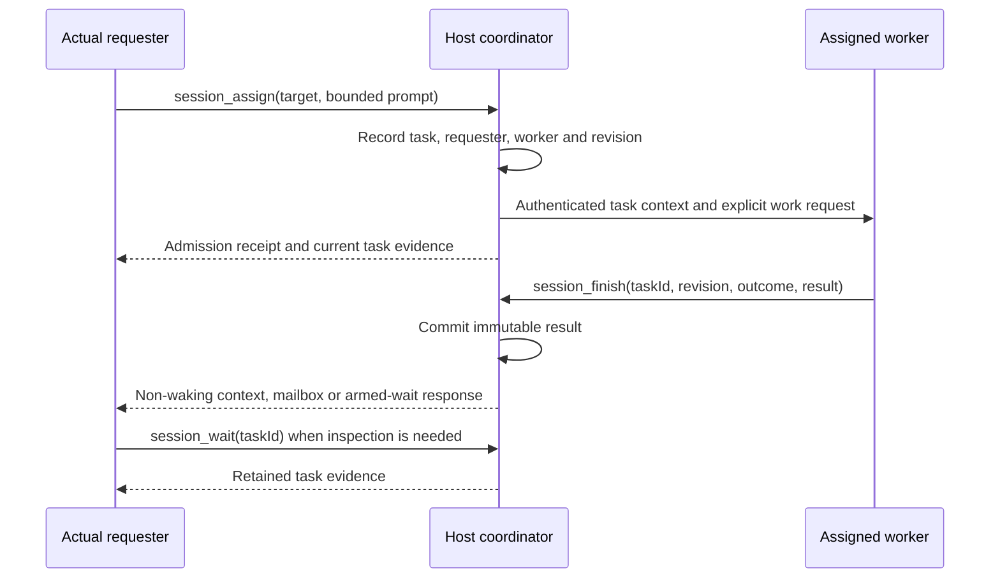

# Session coordination v2

Implementation design and validation record — 2026-10-24. This document records protocol decisions, source behavior, and qualified evidence from disposable hosts. The final artifact is candidate25; the earlier candidate17 quiet probe, subsequent cold-note retrieval, final cleanup and additional-work accounting are complete. Passing these checks does not establish durable coordination across restarts or improved model outcomes. The [current session-control contract](../contracts/AGENT-SESSION-CONTROL.md) remains the reference for implemented behavior.

The earlier [cross-session investigation](CROSS-SESSION-COMMUNICATION-AND-CONTROL.md) is retained as the historical evidence record. This document supersedes its proposed operation names where the choices below differ.

## Decision

Keep three coordination scopes distinct:

1. Use a bounded `subagent` for the ordinary focused question that should return directly to the caller.
2. Use independent, host-local Pie sessions when work needs a persistent context, human steering, or peer coordination.
3. Use shared resource reservations only for cooperative agreements between sessions on this host; existing build/provider gates remain authoritative for their own scopes.

For independent sessions, separate the information plane from the work plane. A note supplies context and does not create a reply obligation or wake an idle model turn. An assignment creates explicit work, fixes its requester and worker, and starts a turn. The worker explicitly finishes the accepted revision; the coordinator records the result before any notification attempt. A bounded wait or later inspection observes task evidence. It does not re-run work or infer success from idleness.

This design deliberately has no general task board, scheduler, automatic retry, cross-host bus, durable restart replay, or process-killing resource lock. It is a falsifiable candidate, not a measured usability conclusion. The extra task tools may cost more than a guidance-only or note/assignment-only simplification. Evaluate them against simpler controls before enabling broadly.

An offline comparison of built inventory factories records that surface cost: the baseline's one backend tool occupied 4,906 bytes of compact JSON definitions, versus 9,277 bytes for the final six-tool candidate25 family; compact guidance metadata increased by 2,825 bytes. These are UTF-8 metadata sizes, not provider-payload capture, tokenizer counts, billed usage, or evidence of improved task quality (`candidate-25-tool-surface-comparison.json`). Pruning can hide optional tools, but workflow dependencies deliberately preserve assignment and wait when lifecycle control remains available.

| Observed problem or required workflow | Implemented response | What still requires judgment |
| --- | --- | --- |
| Informational contact starts another turn and invites overlapping acknowledgements | `session_send` and result notices never wake idle sessions; bounded queues, rate limits and recent-body deduplication limit traffic. | A peer needing new work must receive an assignment; an idle requester must wait or inspect later. |
| An unrelated requester delegates to a session another agent created | Each assignment records its actual requester; only its worker may commit the accepted revision's result. | Creator authority still governs settings and close/delete; peer contact does not grant lifecycle ownership. |
| Admission, execution, final text and successful work are conflated | Separate accepted/running/awaiting-result/terminal evidence, explicit finish, and unknown acknowledgement receipts. | Completed remains a worker claim; the requester verifies the deliverable and tests. |
| Independent workers guess requirements the controller already read | Tool guidance requires contract/file references, exact output requirements and checks; settings inheritance remains separate from task context. | Small models can still omit or misunderstand context. Preserved failed/repair trials demonstrate that limit. |
| A closed tab leaves its worker and descendants running | Ordinary close now invokes fenced runtime release and waits for confirmed teardown; self-close uses a response handoff. | Explicit self-close initially acknowledges acceptance; verify final process death separately. |
| Peers contend over checkout checks or known heavy work | Host/worker observations identify measured pressure and known owners; exact named leases require start, renewal and release. | Leases are cooperative, worker samples exclude descendants, and active expiry cannot prove work stopped. |
| A lost response leads to blind retry and duplicate work | Request-key inspection, immutable finishes and unknown-state reservation preserve uncertainty without automatic replay. | After coordinator restart, retained history is diagnostic; unavailable task evidence does not establish non-execution. |

For everyday delegation, create a cold worker in the intended bucket, assign one bounded deliverable with file ownership and exact checks, continue independent work, then inspect/wait and verify the result before closing it. For sustained collaboration, retain the session, send decisions as notes, and assign another task only after its current task is terminal. For shared expensive work, agree on the exact resource name before acquire/start, choose a TTL covering work and cleanup, renew before expiry, and release after owned work stops. These workflows require no status-ping or transcript-polling loop.



The requester may arm its wait before finish or inspect afterward. A receipt can be unknown even while later execution/result evidence is conclusive; the diagram does not imply an atomic send or guaranteed notification. Notes use the same non-waking information route without creating a task or reply obligation.

## Evidence and qualification

The historical investigation reviewed a canonical analytics snapshot for 2026-10-21 00:00 UTC through 2026-10-23 20:30:10.135 UTC: 503 observed `session_control` calls across 28 root sessions, 499 captured as `completed` and 4 as `failed`. These are tool-observation outcomes, not task success, recipient processing, or a complete transport reliability denominator. Some transcript-reported unavailable outcomes are not represented in those captured failures; capture coverage was not proven complete.

The accompanying transcript sample was selected for contrasting workflows, not randomly sampled or exhaustively reviewed. Its evidence supports these qualified conclusions:

- A queued resource grant was reported hours later as still held; a latest-start acknowledgement is needed before work consumes a reservation. This does not independently prove what a process did while the grant was held.
- A sender reported unavailable/unknown communication and the peer later inspected the sender transcript. That establishes ambiguity in the observed workflow, not a measured delivery rate.
- A delayed result was followed by another confirmation request and the user called out spam. The evidence establishes overlapping sends, not duplicate transport delivery.
- Exact-address routing, delayed consumption, and explicit resource-owner/release exchanges also worked. Preserve those capabilities and make their state visible.
- A repository-wide snapshot was invalidated by unrelated writes, showing that non-overlapping source files do not make shared tests, contracts, build gates, or snapshots independent.

The exact session IDs, entry anchors, dates, and evidence limits are preserved in the [historical investigation](CROSS-SESSION-COMMUNICATION-AND-CONTROL.md#observations-that-drive-the-proposal). Do not treat historical titles as stable identifiers. An agent's report that a process stopped is not independent OS verification.

No token or dollar cost is derived from transcript length or the tool-call counts above. Keep model-reported usage (prompt, completion, cached and reasoning tokens when supplied) distinct from provider billing data and local estimates. A response usage object is not automatically the account-billed amount; report the source, coverage, provider, model, and time window for any future cost comparison.

## Coordination scopes and alternatives

### Tree delegation versus independent sessions

The bounded-subagent path already has a direct call/result relationship and should remain the default for a focused task. Independent sessions have separate long-lived histories and can be steered by a person, but require routing, liveness, and ownership state.

OpenAI's [Responses multi-agent guide](https://developers.openai.com/api/docs/guides/responses-multi-agent) describes hosted tree delegation for concrete, bounded parallel work. It also cautions that multi-agent can increase token use and is less useful when work depends on a single ordered chain or agents contend over shared mutable resources. That supports retaining direct bounded delegation and explicitly coordinating shared state. It does not establish that Pie's independent sessions behave like hosted subagents or that either design improves this workload.

Do not make unrelated host sessions into an implicit parent/child tree. A task's requester is the session that made that assignment, regardless of who originally created the worker. Creator permissions for lifecycle/configuration remain a separate authority and must not decide who receives task results.

Independent sessions start with their own history. The tool guidance explicitly distinguishes settings inheritance from conversation context and asks callers to pass relevant contracts/file references and exact output requirements. A live Luna controller read a contract but omitted its exact field names when delegating; two workers guessed a different output key, and the controller initially accepted their claims. Clearer guidance addresses that observed ambiguity; it does not make task completion claims independently verified or establish an improvement rate.

### Automatic wake, queued notes, and explicit work

An information send that wakes an idle model turn conflates “read this context” with “do new work.” A queue-only send followed by an automatic wake is still a wake from the recipient's perspective. This design instead makes `session_send` non-waking and retained for the recipient's next run or explicit wait. A question or request that needs a new answer uses `session_assign`.

An active recipient may receive a note at its existing safe boundary. That is not permission to interrupt or create a second task. Assignment admission rejects a worker with active or pending work; it never silently merges instructions. If work must be re-scoped, the requester amends only an `awaiting-result` task using its current revision. Interrupt remains an explicit lifecycle action and does not itself prove process cleanup or task completion.

### Explicit finish versus inferred final text

Inferring success from the last assistant message after a run settles is convenient but confuses an execution boundary with a semantic claim that the accepted task was completed. The selected candidate requires `session_finish` with the task ID, accepted revision, outcome, and concise result/evidence. Finishes are worker-authenticated and immutable within a revision: an identical retry returns the same committed result; stale or conflicting finishes reject.

The cost is an extra call and a forgotten finish. A settled run without a finish becomes `awaiting-result`; it is not converted to success. Lifecycle evidence may record interruption or failure, but cannot manufacture a missing deliverable. Fixed requester ownership already removes the creator-versus-requester routing defect, but it does not say whether the task succeeded, preserve an outcome claim for the accepted revision, or make a final result immutable.

The first candidate02 naturalistic review is environment-confounded: the launcher omitted `ProgramFiles`, the SDK selected WSL `/bin/bash`, and workers failed to start correctly. Its missing finishes are not evidence of a normal-run forgotten-finish rate. In a clean trial, verify the resolved Git Bash path before starting and separate startup failures from runs that started and settled. Observe whether the current task/revision receives an explicit finish, whether the result is complete and useful, how much repair or requester follow-up is needed, and the additional call/cost. A small trial can reveal concrete failure modes and usability friction; it cannot establish a reliable population rate or justify a numeric cutoff.

If clean runs repeatedly settle without a finish, a future hybrid candidate is to capture a bounded, task-correlated draft at the exact `agent.settled` operation and expose it as unverified output to the fixed requester. Keep that draft distinct from the immutable explicit result and never label execution settlement as task success. Compare its usefulness and repair burden against explicit finish before changing the default. Do not add background nudges or retries to hide the failure mode.

### Resource locks versus cooperative leases

The registry coordinates callers that honor it; it does not lock files, reserve RAM at the OS, kill processes, or make an uncooperative session safe. Resource names are exact canonical names, not path trees: `checkout:pie` and `checkout:pie:docs` are unrelated. Acquire and wait default to exclusive mode. Shared mode must be requested explicitly and only coexists with other shared holders of that exact name.

An acquired lease is initially `reserved` and must be explicitly `start`ed before its bounded `startBy` deadline. An unstarted reservation expires and frees the name. Active leases require explicit renewal and release. Active TTL expiry becomes `expired-active` and continues to conflict: expiry is not evidence that work or child processes stopped. Owner retirement changes active leases to `orphaned`, still blocking. Reclaim is a separate assertion with a reason and `confirmStopped: true`; it records that the caller verified the work stopped, but performs no such verification itself.

The registry emits availability-increasing events for release, explicit reclaim, unstarted-grant expiry, and retirement of a reserved owner. Start, renewal, active expiry, and active orphaning do not signal availability. `session_resources action: wait` subscribes with a bounded deadline and returns a fresh status snapshot when the requested mode is compatible; it never queues, auto-acquires, or grants fairness. Resource wait has deterministic registration-race, cancellation, timeout, shared-mode, release, reclaim and expiry coverage. Shared/exclusive contenders may race after waking; existing build/provider gates are not replaced. A lost, closed, or uncooperative owner can therefore require human process verification and explicit reclaim.

Acquire and wait share one resource-name normalizer: trim, bound to 96 Unicode code points, lowercase without a locale, then bound again because case conversion can expand text. Purposes and reclaim reasons are bounded to 240 Unicode code points after trimming, matching their schemas. This fixes acquisition/wait and schema/handler mismatches for non-ASCII text. It deliberately does not apply Unicode normalization or infer filesystem relationships. Focused coverage includes CJK, supplementary-plane characters, case expansion, and the exact boundaries.

Measured host facts (total/free memory, logical CPU count, coordinator RSS) and available per-worker memory samples are observations, not predictions or admission guarantees. They can be stale immediately and do not prove an allocation is available. Do not translate them into an invented “estimated memory reservation” or imply OS enforcement.

## Source comparison checked during implementation

The implementation review re-opened the pinned Codex source and current Claude documentation on 2026-10-24. These comparisons concern protocol behavior; they do not establish relative task quality or performance.

| Approach | Useful precedent | Pie decision and cost |
| --- | --- | --- |
| Codex v2 information versus follow-up work | The pinned [`send_message`](https://github.com/openai/codex/blob/970111f6cb62cc02fe36a82ea7d71b37a2889c97/codex-rs/core/src/tools/handlers/multi_agents_v2/send_message.rs) selects `QueueOnly`; [`followup_task`](https://github.com/openai/codex/blob/970111f6cb62cc02fe36a82ea7d71b37a2889c97/codex-rs/core/src/tools/handlers/multi_agents_v2/followup_task.rs) selects `TriggerTurn`. | Separate tool names express whether new work is intended. Pie rejects busy assignments instead of silently appending another task. |
| Codex receiver wake policy | The pinned [`turn_input.rs`](https://github.com/openai/codex/blob/970111f6cb62cc02fe36a82ea7d71b37a2889c97/codex-rs/core/src/session/turn_input.rs) also permits pending-mail wake under feature, root, interruption, and collaboration-mode conditions. Queue-only submission alone does not prove an idle receiver stays asleep. | Pie notes/results have one non-waking rule. An idle requester must arm a wait or inspect later; spontaneous response is deliberately unavailable. |
| Codex captured terminal result | The pinned [`completion.rs`](https://github.com/openai/codex/blob/970111f6cb62cc02fe36a82ea7d71b37a2889c97/codex-rs/core/src/agent/control/completion.rs) routes the result body to the structural parent with `trigger_turn:false`, describes delivery as best effort, and separately emits completion activity to an initiator. | Pie records the actual requester per assignment and stores a result before notification. Explicit finish adds a call and a forgotten-finish failure mode, but prevents a peer's result being routed according to creator lineage. |
| Claude independent-session messaging | [Message delivery and limitations](https://code.claude.com/docs/en/cross-session-messaging#message-delivery) describe safe-boundary active delivery, an idle turn on message arrival, bounded inboxes and loop throttling. Idle notices observe a turn boundary rather than verified work. | Preserve broad peer contact, use non-waking information, and treat queue/rate bounds as separate from task evidence. An idle contact needing an answer requires an assignment. |
| Claude agent teams | [Teams and limitations](https://code.claude.com/docs/en/agent-teams#limitations) describe a shared task list and direct peers, but also forgotten task completion, resume gaps, and slow shutdown. | Keep independent session ownership and explicit result evidence without adding a shared scheduling board. The narrower protocol still needs lifecycle, capacity, and forgotten-finish recovery tests. |

These choices are inferences for Pie's workload. A source precedent does not justify copying another product's hidden wake policy, permission system, tree scope, or task-status guarantees.

## Implemented source behavior

The candidate advertises six separate tools: `session_control`, `session_send`, `session_assign`, `session_finish`, `session_wait`, and `session_resources`. Session lifecycle operations such as list/create/read/settings/interrupt/close remain on `session_control`; collaboration operations do not smuggle lifecycle settings into messages.

Historical legacy creator-attribution rows are diagnostic transcript context only; they never reconstruct a handoff after a coordinator restart. The internal compatibility path can still perform a one-shot standard `message.send` handoff to the creator when a currently authenticated, newly consumed legacy `expectReply: true` message is observed. The six primary tools do not advertise that behavior, and new primary assignments do not establish legacy creator handoffs.

The public compact session address is exactly 31 characters (`pie-session:v1:` plus 16 lowercase hexadecimal digits) and is derived from stable session identity. Historical `pie-reply:v1:` references remain accepted. Both forms resolve only against current live membership; an address is not a capability for a closed session, and display titles never replace identity.

Note admission uses authenticated requester/recipient token buckets: five-message burst and 20 notes per minute per pair, plus 15-message burst and 60 per minute per recipient. Repeating the most recently admitted identical body for the same pair within five seconds returns the prior receipt without a second send, including a known rejection. If that receipt is `unknown`, it stays unknown; the duplicate path does not replay the SDK write. Note bodies are bounded to 16 KiB UTF-8, and task-result notification bodies to 32 KiB.

Coordinator mailboxes cap at 64 items and 256 KiB per recipient, plus 4 MiB and 4,096 items aggregate. Capacity bytes include the complete JSON-encoded routing envelope (owner identities, target path, payload and optional task ID), not only body text. A worker separately tracks pending SDK custom messages up to 32 messages and 256 KiB of complete UTF-8 JSON. Exact custom-message `message_start` or a confirmed SDK queue clear frees a charge. A preflight capacity rejection does not call the SDK; an exception with unknown enqueue outcome retains its charge until consumption, confirmed clear, or worker collection. There is no automatic replay.

Task admission reserves its possible terminal result, error allowance, and state/outcome text before accepting new work. A boundary regression finds the minimum budget that admits a task through the public API, then verifies that started, unknown, awaiting-result, and full-result settlement remain possible. The 4 MiB task text budget counts logical UTF-8 field bytes (including prompt, participant metadata, and reserved space), not JSON-escaped transport expansion. Active or ambiguous task state is not evicted to make room; old terminal evidence may be. The coordinator owns the single wait implementation; the registry supplies committed changes rather than maintaining a second set of timers and subscriptions. Cancellation only preserves unread mailbox information when cancellation wins before completion; a completion/Stop or transport-loss race may consume an item, with no automatic replay. Authoritative task results remain separately inspectable.

An assignment becomes `running` only on correlated turn-start evidence: the current worker's semantic `live.semantic` event with `kind: 'turn.started'`, or the compatibility `message.started` event. Generic phase changes and unrelated worker events do not establish that the assigned model turn began. This corrects the earlier status gap where an accepted task could remain accepted after its semantic turn start.

A delayed lost-ack report cannot regress correlated running/settled execution to admission-unknown. Conclusive start, settlement, or finish also clears transient admission error text from the current task record. The original mutation receipt remains the place to inspect transport ambiguity. Final review found a concrete remaining edge: the worker could emit correlated execution evidence and then lose its IPC response, while generic error handling incorrectly called that rejection. Candidate20 restricts conclusive rejection to an explicit pre-admission error-code set, treats other failures as unknown, and preserves later task evidence even if a rejected acknowledgement arrives. Focused cases cover running, awaiting-result and already-finished tasks, typed internal errors and known precommit rejection; none automatically replay work.

Unfiltered waits project the 16 most recently changed visible task records. They shorten a result notice only when that task's evidence is actually included; other notices retain their bounded status/result body and targeted inspection guidance. A 17-result regression covers an older task finishing last. Separate capacity tests exercise 128 concurrent logical wait owners, overflow and duplicate-owner rejection, slot reuse after cancellation/retirement, recipient isolation, and aggregate mailbox backpressure without dropping accepted notes. These tests use fake non-waking ports and do not qualify 128 live worker processes.

Resource status reports coordinator-observed host total/free RAM, logical CPUs and coordinator RSS with `observedAt`, and up to 256 worker samples with compact session address/title, worker ID/generation, PID when known, per-worker sample time, age, and `fresh`/`stale`/`unavailable` status. It separately reports total worker count and whether samples were truncated. Worker RSS/heap/external values describe that process and exclude child processes; these observations do not reserve capacity. Public resource leases show an owner's address/title or a `{ deleted: true }` tombstone. Private deletion erases address/title/purpose/prior reclaim reason, while an active deleted owner's lease becomes orphaned and continues blocking until release or exact-lease verified reclaim.

This is a material attribution limit for compilation, shell work, and context helpers: a small worker RSS can coexist with a large descendant process. The live candidate02 observation included a helper near 258 MB working set and 1.27 GB private bytes; neither value is interchangeable with the worker's RSS or proof of a leak. Tool guidance makes the distinction explicit. An agent can observe host pressure, contact the owner of known heavy work, and serialize cooperative heavy jobs with a named lease, but cannot discover every session's complete process-tree footprint from this snapshot. Sampling owned process trees is a possible later observability improvement, not an implemented guarantee.

Queued-message replacement refuses before clearing if a tracked custom note is pending and holds a per-session queue-edit gate through requeue and rollback. The gate rejects new note/result deliveries before SDK enqueue. The edit receives `SESSION_NOTE_DELIVERY_PENDING`; a note rejected during the gate must be deliberately retried, subject to the five-second same-body receipt deduplication window. Stop and explicit queue clear may intentionally drop queued notes. None of these paths replay a consumed note or an uncertain SDK write.

Cold mailbox draining retains capacity charges during dispatch, gates concurrent drains by owner, and preclaims an oldest-first batch of at most eight entries and a 64 KiB full-envelope target (one larger admitted entry may proceed). A single 20-second deadline bounds dispatch below the worker's 30-second drain RPC. Known pre-enqueue failures retain the entry and suffix; an ambiguous attempted write is removed without replay and stops the batch. Releasing claims wakes matching waits if retained information becomes available. Ordinary turns continue with a visible host delivery incident on failure; this incident is not model context, and remaining mail can be consumed by explicit wait or a later ordinary send.

Ordinary close now has a separate non-destructive host-to-coordinator runtime-release step. It fences admission, joins concurrent release/promotion, and confirms worker retirement before host cleanup reports close completion. Durable history and settings remain reopenable in a fresh worker generation. A failed/unconfirmed stop does not become `closed:true`. Self-close retains the existing response-delivered handoff before stop/release; private deletion retains its existing forget barrier.

## Interface examples

Addresses come from the coordinator's live session inventory or create result. Use the returned identity-bound address rather than a display title when possible; the coordinator resolves it to current live membership. A title is display metadata and title reuse must not redirect existing tasks. The following payloads are illustrative shapes; the tool schemas are authoritative and may impose additional bounds.

**Send information without starting an idle turn:**

```json
{
  "tool": "session_send",
  "arguments": {
    "target": "pie-session:v1:0123456789abcdef",
    "message": "The format decision is Y-up. Please keep your fixture running; I will release the checkout after the shared test."
  }
}
```

The receipt means the note was admitted to a hot safe-boundary route or retained for later consumption, according to the response. It is not a request for an answer. A note cannot carry a wake flag, task completion claim, or caller-supplied sender identity.

**Assign bounded work and record the requester independently of creator:**

```json
{
  "tool": "session_assign",
  "arguments": {
    "target": "pie-session:v1:0123456789abcdef",
    "prompt": "Inspect the decoder tests. Return the failing case, root cause, and one focused fix. Do not modify the shared snapshot file."
  }
}
```

On acceptance, the coordinator returns a task ID, revision, requester/worker display addresses, and admission state. A busy worker is rejected before task admission. If the acceptance acknowledgement is unknown, inspect the returned request key/operation status; do not create a replacement assignment automatically.

**Finish only the authenticated accepted task revision:**

```json
{
  "tool": "session_finish",
  "arguments": {
    "taskId": "task-id-from-assignment",
    "revision": 1,
    "outcome": "completed",
    "result": "The decoder failed on case 17 because the fixture expected Y-down. Updated the focused expectation; the targeted test passed."
  }
}
```

`blocked`, `failed`, and `cancelled` are distinct outcomes. A finish does not close the session or claim that the requester has read the result. The requester can inspect/wait for the record even if the non-waking result notification is lost.

**Wait only when the result is on the critical path:**

```json
{
  "tool": "session_wait",
  "arguments": {
    "taskIds": ["task-id-from-assignment"],
    "timeoutMs": 60000
  }
}
```

An already-available result returns immediately. `timeoutMs: 0` performs inspection. Waits are bounded and cancellable; task IDs are authorized against the authenticated requester/worker identity, not trusted from the payload. A task-filtered wait preserves unrelated mailbox items. A timeout or `awaiting-result` state is not success.

**Coordinate a scarce shared resource:**

```json
{
  "tool": "session_resources",
  "arguments": { "action": "acquire", "name": "checkout:pie", "purpose": "Run the shared integration fixture read-only", "mode": "exclusive" }
}
```

Call `start` successfully with the returned `leaseId` before beginning the resource-consuming work; renew during long-running work, then release once the work and owned processes stop. If acquire returns busy, resource wait observes availability but never creates the next grant. The winner still has to acquire and start explicitly. There is no FIFO ordering, priority, recursive path matching, or automatic stale-active cleanup.

## Sender, receiver, identity, and notification rules

- The host coordinator derives caller/worker identities from the authenticated session route. Payload fields cannot select another sender, requester, or task owner.
- Assignment fixes requester, worker, task ID and revision. `session_finish` is accepted only from the assigned worker for the current revision. The requester is the same whether it created the worker or is an unrelated live peer.
- Task results are committed before notification. A notification may be delivered at an existing safe boundary or retained for an explicit wait; neither delivery attempt nor successful send receipt is proof that the receiver processed it.
- Notes and task records use coordinator-lifetime retention in this implementation. Explicit wait/status is the recovery path for delayed/lost notification. A request key can resolve an uncertain mutation while that coordinator remains alive.
- A coordinator restart discards coordinator-lifetime tasks, inboxes, waiters, and reservations. “Unavailable” means evidence is unavailable in this process; it does not prove the mutation never happened. Do not replay notes/tasks/resources or recreate work after restart.
- Ordinary close/retire preserves retained inbox information; private deletion purges the deleting participant's private task/mail state and inbound/outbound mailbox data as defined by the coordinator. Close and delete are not result receipts. Existing lifecycle authority continues to own permission checks and host shutdown.
- Cancellation stops/cancels a wait and removes its subscription; it does not cancel another session's wait or imply that an assigned worker's OS processes stopped. Session interrupt/close remain their existing host lifecycle behavior.

### Receipt vocabulary

Keep four different facts explicit: (1) a mutation was admitted/rejected, (2) a task result was committed, (3) a notification was attempted/accepted by a route, and (4) a requester inspected the result. Unknown acknowledgement is not a rejection; inspect the original request or task. Never automatically resend a note after hot delivery acknowledgement loss, create a duplicate task, or retry a conflicting finish. A worker result is a claim with evidence for requester review, not a cryptographic or test-run attestation.

This separation follows a general messaging principle, not a claim that Pie implements a broker: RabbitMQ documents publisher confirms and consumer delivery acknowledgements as orthogonal signals, and describes consumer acknowledgement after successful processing ([RabbitMQ confirms and acknowledgements](https://www.rabbitmq.com/docs/confirms)). Pie's in-memory route does not inherit RabbitMQ guarantees; this reference only motivates naming the distinct events instead of calling all of them “delivered.”

## Settings, providers, and existing authority

Creating an independent session continues to inherit execution settings, provider choices, system-prompt choices, and model-bucket policy from the creator's session. Creation selects within the named `small`, `medium`, or `frontier` bucket and validates provider/model availability through existing provider management. Directly assigning an already-live peer does not silently rewrite its provider or settings. `settings.set` remains a separate persistent override with existing permissions. The new protocol must not replace provider availability, model bucket selection, host settings capture/apply, or settings inheritance with ad hoc defaults.

The user authorized OpenAI-only live model validation, preferred Luna, and set a US$20 additional test/delegation budget. All external trial and delegate model calls use Luna. Deterministic protocol tests use fake ports or loopback HTTP fixtures rather than external providers. Report actual model/provider usage separately from billing and include delegated/test usage in the additional-work estimate; do not extrapolate dollar cost from message lengths.

## Failure, retention, and race handling

| Failure or race | Required behavior |
| --- | --- |
| Busy worker at assignment | Reject before task record admission; requester may select another worker or wait. No silent queue. |
| Assignment accepted but acknowledgement lost | Request-key operation status inspects the original request. No automatic second assignment. |
| A late rejected acknowledgement follows correlated execution or finish | Preserve the current running/awaiting-result/terminal task and immutable result. Classify the acknowledgement as unknown, with inspection guidance; do not throw a misleading admission rejection or replay. |
| Private participant deletion while assignment acknowledgement is pending | Deletion purges that participant's task evidence. When the delayed acknowledgement returns, report unknown without restoring the purged accepted record, leaking participant addresses or a stale receipt, or automatically replaying the assignment. Normal close retains terminal unknown evidence under the coordinator-lifetime policy. |
| Finish repeats identically | Return the same committed result without creating another notification or version of the result. |
| Finish conflicts or uses stale revision | Reject without changing current task. Resume only with current task ID/revision after `awaiting-result`. |
| Worker settles without finish | Record `awaiting-result`; do not infer successful output. Amendment can start a new accepted revision. |
| Result notification route fails | Keep authoritative task record. Do not replay notification automatically; requester inspects with wait/status. |
| Wait sees existing task/result before subscribing | Return immediately. Registration/check occurs synchronously so commit cannot slip between check and subscription on the host event loop. |
| Wait aborts before or after registration | Cancel by owner-scoped wait ID and remove listener/timer. An unknown/forged ID cannot cancel another session's wait. |
| Resource releases around wait registration | Recheck compatibility atomically after registering; if compatible already, return current status immediately. Otherwise wait for a compatible change/deadline. |
| Shared lease is released while shared and exclusive callers wait | Re-evaluate each waiter's requested mode. A shared caller may proceed while any shared holder remains; an exclusive caller waits until every conflict is gone. No reservation is auto-granted. |
| Unstarted lease reaches start deadline | Sweep/expiry timer releases the reservation and signals a compatible waiter. Starting after deadline rejects. |
| Active lease TTL expires | Mark expired-active but keep it conflicting; do not wake availability waiters. Explicit owner release or caller-verified reclaim is required. |
| Active owner closes | Mark lease orphaned and keep it blocking. The coordinator has not proven cleanup. A human or authorized session must verify stopped work before reclaim. |
| Session closes while waiting | Cancel that session's wait. Do not cancel peer sessions or infer task completion from the close. |
| Coordinator restarts | Return unavailable for prior coordinator-lifetime records. No automatic replay or duplicate recovery. |
| Capacity bound reached | Return explicit capacity failure; do not evict active state or silently drop retained notes. |

## Validation report and gates

Final candidate25 (`87feaaf7688020569cab`) passed TypeScript/Vite build verification and verified SDK materialization. Its selected regression across 389 files passed 4,184 of 4,206 tests, with zero failures and 22 skips, in 310,830 ms (`regression-25.tap`). Its built-asset Playwright checks passed 2/2 at phone/tablet widths with reload. Ten representative calls across all six compiled tool definitions passed the actual verified-SDK argument validator with external fetch disabled (`candidate-25-built-sdk-schema-validation.json`). Changed-source lint and the final affected-file lint checks passed. Its live create/assign/finish/self-close workflow passed with the limits recorded below. Candidate17's separate 2-hour-9-minute quiet probe and subsequent retained-note retrieval also passed. These checks do not qualify the user's currently running extension generation.

Named receipts in this report reside in the local ignored evidence directory `C:\dev\repos\pie\.cache\session-control-20261024\validation`. They include the original failed attempts, source snapshots, TAP output, browser captures and cleanup receipts; those generated files are not part of the Git change. `final-validation-index.json` records hashes of the main handoff receipts. `source-snapshot-build25.json`, `source-snapshot-final.json` and `build25-to-final-source-comparison.json` distinguish the built source from later report edits. JSON-format checks tolerate a UTF-8 BOM; original console captures with different encoding or trailing console text are preserved byte-for-byte as `.log`, with the filename corrections recorded separately.

| Evidence | Local receipt |
| --- | --- |
| Final selected regression | `regression-25.tap` |
| Original selected test-runner command and scope | `regression-25-command.json` |
| Compiled schemas through verified SDK | `candidate-25-built-sdk-schema-validation.json` |
| Phone/tablet display and reload | `playwright-display-25/.last-run.json` |
| Actual pruning, finish, wait and self-close | `candidate-25-self-close-evidence.json` |
| Long idle observation and its limits | `candidate-17-final-quiet-evidence.json` |
| Retained cold-note consumption after that window | `candidate-17-note-retrieval-evidence.json` |
| Final host teardown | `candidate-17-final-shutdown-receipt.json`, `candidate-25-profile-24-shutdown-receipt.json` |
| Additional-work usage and coverage | `final-additional-usage-accounting.json` |

For offline schema reproduction from the repository, run `proto run node -- .cache\session-control-20261024\validation\validate-built-session-tools.cjs C:\dev\scratch\pie-session-control-20261024-1044\candidate-25`. The selected regression used the checked-in `proto run pnpm -- run test:file --sdk-path <verified-SDK-package-root> <selected-test-paths> -- --test-reporter=tap --test-reporter-destination=<report>` runner; its exact original command and selected directories are captured in `regression-25-command.json`. That run used candidate24's immutable SDK package with the identical verified identity recorded above; final25's separate schema check used its own materialized package. Live runners deliberately remain disposable harnesses rather than supported product commands; reusing their old profiles or replaying their prompts is not a clean fresh-host evaluation.

Candidate23 (`3d29e223b2e3ec983e34`) had passed 4,181 of 4,203 selected tests and 2/2 built-asset browser cases, but its live SDK check caught the optional-field regression described below. Candidate24 (`97ca896715544431aa50`) corrected that schema, passed 4,182 of 4,204 selected tests and ten compiled-SDK validation cases. Candidate25 adds the final mailbox accounting corrections. The earlier source-level passes do not override 23's failed runtime check.

Earlier recorded regressions remain tied to their source snapshots: candidate09 ran 364 files with 3,954 passes of 3,968 tests and 14 skips; candidate16 (`b70f5b34cace7f97eca2`) ran 389 files with 4,175 passes of 4,197 tests and 22 skips; candidate20 (`4299a3282f12fc6503b1`) ran the same selection with 4,179 passes of 4,201 tests and 22 skips. All had zero failures and passed isolated build verification. Candidate17 (`ac3ec2971b12e7250a87`) adds the sticky-header CSS fix to16;20 also includes resource-wait/TTL guidance, lint cleanup and the late assignment-acknowledgement correction. Candidate14 and candidate15 both built as `debfe13b6238c84b3484` and were not live-qualified.

Skipped tests are accounted for separately. Twelve platform-specific Git-diff baseline cases were not exercised. Two provider-runtime cases passed separately with the verified SDK and external network blocked. Five opt-in verified-SDK cases passed against artifact19's identical SDK identity: dynamic tool activation, durable terminal facts across processes, system-prompt/provider-payload behavior (two cases), and image persistence (`real-sdk-opt-in-19.tap`). Both spawned-worker starvation scenarios passed with isolated fake localhost providers (`worker-liveness-20-isolated-paths.tap`; three passes including its unit-boundary case). The optional crash matrix reaches its final SDK write-ownership trace assertion after its worker kill, descendant cleanup, other-session controls, stale UI rejection, queued provider release, replacement-worker reply and no-replay checks. It fails because this immutable SDK has no write-ownership trace hook (`crash-matrix-20-helper-final.tap`); exclusive ownership overlap is therefore unverified by that matrix. Its assertion has not been removed or weakened. Earlier opt-in setup failures are retained, including an invalid harness readiness check against public `session.list`; they do not establish a product hydration defect.

Passing deterministic tests establish local state-machine behavior under fake ports. They do not establish user comprehension, transport delivery across a real host, process cleanup, persistence, restart recovery, provider performance, cost savings, or better task success. Resource waiting is implemented and source-tested, but its behavior remains advisory and does not grant a lease or establish OS-level resource availability.

Use these engineering qualification gates, and keep their limits separate from comparative model-quality claims:

1. **Source and schema parity:** verify primary and inventory schemas, lifecycle/pruning protections, subagent read-only restrictions, and effective settings/provider inheritance. Capture the actual registered schema and artifact identity rather than relying on source names alone.
2. **Protocol tests:** run focused no-provider tests for all task, note, wait and resource paths; include check/register races, resource release/reclaim/expiry, cancellation, capacity, ownership spoofing, wait timeouts, and active-expired/orphaned blockers.
3. **Host lifecycle tests:** prove close/delete, participant retirement, busy assignment, interrupt, cold/hot session transitions, and title reuse do not misroute work or claim external process cleanup.
4. **Runtime qualification:** build/materialize the host artifact and verify the loaded copy. A source test is not evidence that the user's installed generation advertises or executes these tools.
5. **Disposable-host comparison:** test the incumbent behavior and the selected split against the reported failure modes. A guidance-only instruction must not be credited with a non-waking transport guarantee: the baseline counterexample tests that distinction directly. Compare ordinary deliverables with the same provider/model where practical, and label unmatched or environment-confounded trials. The task-record rationale also needs ownership, immutable-finish and failure-injection evidence; a mechanical transport comparison does not establish better model task quality.
6. **Measure useful outcomes:** score deliverable correctness, requested-result misses, duplicate/wrong-recipient results, false completion, forgotten finish, incidental wakes, polling, latency, and actual coordination cost separately. Preserve timed-out and failed runs. Use provider usage/billing sources with stated coverage; do not report transcript character counts as tokens or spend.
7. **Rollout decision:** require fixes for the exercised failure modes and representative workflows, with no unresolved schema, identity, close/privacy, lost-ack, active-resource, or restart-retention defect. Simplify if concrete repair burden outweighs the extra evidence. Do not claim statistical outperformance of guidance-only or split-only designs without a matched evaluation; that broader comparison remains unmeasured.

## Live validation

All trials use disposable host/profile directories outside the repository and loopback-only browser servers. They do not replace or reload the active VS Code extension. Each artifact uses the same verified SDK artifact identity `13d3555992ca1a6fc63180e956e4decaba2e3611bc818b7c3a3da3a52fd09599` (0.80.6, upstream pin `2b3fda9921b5590f285165287bd442a25817f17b`); its manifest payload SHA-256 is `640b0fe4e07346348c5385e3d0952d1b36891e7ca8e03bc3baa72245fe9088ec`. Only OpenAI `openai-codex` / `gpt-6-luna` has been invoked in these Pie trials. Raw transcripts establish ordering and payloads; cost/token aggregates below use the canonical normalized analytics view.

| Qualified artifact | Observed behavior | Limit of the evidence |
| --- | --- | --- |
| Baseline `3f245b521eb3bd44f39f` | Sending an informational legacy message to a cold peer started an additional model request. | A guidance-only “do not acknowledge” instruction cannot establish a non-waking transport rule. This is one mechanical counterexample, not a task-quality comparison. |
| Candidate01 `89fdf8c2581a9c28d0d1` | A cold note stayed cold with no provider usage. A later explicit assignment consumed it. A completed result appended to an idle requester without starting another turn; an armed task wait received the result. Browser capture showed separate sender/result presentation. | Small directed protocol probes; no estimate of ordinary task success. A no-ID wait also returned a consumed historical terminal task too early; this defect was fixed before candidate02. |
| Candidate02 `413d6c8bf6ed56086556` | No-ID wait stayed pending for 841 ms until fresh information. Resource wait stayed pending for 20.036 seconds until release, followed by a separate acquire/start/release. A peer that did not create its worker received the assigned result; creator-only settings/close authority remained separate. Requester interrupt cancelled its current task without changing a prior immutable result. | Timings come from captured request boundaries. The model's own “1.1 seconds” narration was inaccurate. These probes do not verify OS cleanup or resource enforcement. |
| Candidate02 naturalistic review | A model mixed pieces of two long legacy reply references; routing rejected the malformed address without admitting work. A later exact-title recovery worked. Workers also encountered shell startup failures in the test profile. | The launcher omitted `ProgramFiles`, causing SDK shell discovery to select WSL instead of installed Git Bash. This run is inconclusive for ordinary delegation quality and forgotten-finish frequency. It motivated compact current addresses and a corrected, explicitly verified shell profile. |
| Candidate04 `720e99b8aa6eed148524`, profile03 | Three independent Luna workers implemented separate receipt parser/summary/formatter modules. All three called explicit finish, results reached the controller, and the controller closed them. Root's authoritative Proto integration command passed 8/8; contract/test/pipeline hashes were unchanged. | The controller's Proto command failed under the artificial home-directory environment (WASM plugin configuration); its direct Node fallback is not checked-in-runner qualification. This demonstrates scoped file work/result collection, not a normal-run success rate. The run took about 75 seconds and 31 provider invocations. |
| Candidate04 close/process inspection | Exact session-to-PID evidence showed worker PIDs 12468, 19792, and 32988 still alive after their `closed:true` receipts; four PowerShell guardians also remained. Source tracing confirmed ordinary close had no runtime release call. The root force-terminated owned host PID 16624 and its owned process tree. | This was a confirmed close/runtime-release defect, not evidence of unbounded allocation growth. The non-destructive release step was added afterward. Candidate09's separate first-wave process confusion is described below and does not undo this evidence. |
| Candidate05 `120bd384fb02e41886a7` | A cold note stayed cold; the next assignment's automatic control-lane drain appended one custom note before the assignment and model turn, without FIFO deadlock. A subsequent explicit wait returned an empty mailbox. | The model incorrectly inferred “note absent” from that empty wait; durable append is established, exact serialized provider payload was not captured, and correct semantic consumption is not established by this run. The test harness accidentally reused profile03, so its 12 invocations are a timestamp-scoped delta, not an isolated-profile measurement. |

The following directed probes used the candidate09 host artifact recorded as build `289313d61d7fbc763c72`. They qualify only the observed protocol edges, not final candidate16 or a representative model-quality rate.

| Candidate09 probe | Observed behavior | Limit of the evidence |
| --- | --- | --- |
| Six-shard waves trial and repair | The first recorded run was incomplete: workers emitted the wrong summary key (`sum` instead of contract `total`) and shard 04 was omitted. Those failed task results and original files remain preserved. With the fixed contract instructions and original inputs, three explicit repair assignments replaced shards 01/02 and added shard 04; all six outputs were independently inspected, inputs/contract/test remained unchanged, and the fixture passed 7/7 tests. Repair workers returned their distinct note tokens in explicit task results. | The initial run remains a failure and is not reclassified by repair. No raw provider-payload bytes were captured, so token checks establish functional return, not wire-level context delivery. Actual SDK pruning telemetry was unavailable; this is not pruning proof. |
| Close/process attribution during the repair | Each of the three repair workers had a pre-close address/PID/RSS snapshot; after `closed:true`, the next resource snapshot contained only the controller, and the exact worker address was gone. | A separate candidate09 first-wave check misattributed PID 28872 after closing shard01: that PID belonged to shard02, which was still active, not to the closed worker. The repair snapshots independently show the three repaired workers exited their observed worker entries; neither observation changes candidate04's confirmed leak. This does not cover every shutdown/failure path. |
| Long bounded wait | A waiter made one `session_wait(timeoutMs:160000)` call. It returned on a note after 139,611 ms; the sender's 130-second wait timed out, sent the note once, and its receipt was accepted. | The measured interval is the request boundary on this host, not a service-level latency guarantee. The model's narration was not used as timing evidence. |
| Stop during a wait | Clicking Stop cancelled the pending wait request; the transcript shows the IPC cancellation error 61 ms after the UI click. A fresh wait then registered and later returned on mail. | One cancellation/recovery probe; it does not establish all UI-stop races or a broad latency distribution. |
| Disabled finish preflight | A fresh worker with the Tools system-prompt entry disabled had no active `session_finish`; an assignment was rejected with an explicit unavailable-tool reason. Its session history contained zero provider messages for the attempted assignment. | A prior attempt hit a stale busy session and was non-qualifying. The clean fresh-target result verifies this particular missing-finish preflight, not actual extension tool-pruning telemetry. Candidate09's pruning extension was absent; candidate16's separate pruning/schema proof is recorded below. |
| Synthetic lease TTL and reclaim | A resource with a synthetic-only name and no process/hardware consumer was acquired and started once. Status showed `expired-active` after its 1,000 ms TTL; caller-confirmed reclaim removed it from status. | This demonstrates the state transition in a safe no-consumer probe. It does not prove TTL stopped a process or that any real hardware/shared file was reserved. Reclaim records caller assertion; it performs no verification itself. |
| Message presentation and size boundary | Candidate16 browser checks passed on phone-width 390 px and tablet-width 800 px, including reload, using candidate16 assets. The main transcript's agent-result header contrast measured 7.2:1. Candidate17's browser checks passed 2/2 and verified the sticky prompt-context bar's Agent/sender/Result labels at opacity 1. Initial create assignment prompts share the 16 KiB UTF-8 bound with `session_assign`, with exact-boundary acceptance and ASCII/multibyte rejection covered by tests. | The size rule is deterministic coordinator/schema behavior, not a measured usability improvement. Candidate17 changes CSS only from candidate16; the runtime regression counts remain the candidate16 source snapshot. |

Candidate16-specific qualification is separate from the candidate09 probes above. The actual candidate16 pruning extension loaded the repository absolute path and source-hash manifest; the root-read `candidate-16-pruning-receipt.json` records Luna/low, successful automatic parsing, and requester wait and worker finish/wait tools retained and used. The offline verified-SDK/network-blocked runtime checks passed 2/2 and cover two broad-suite skips. Browser agent-display checks passed 2/2 at 390 px and 800 px with reload against candidate16 assets; the main renderer header contrast is 7.2:1.

The candidate16 state probe recorded task `5ce...` running at revision 1 at 00:57:50.722, awaiting-result at revision 1 at 00:58:01.640, resuming as revision 2 at 00:58:03.594, and terminal at revision 2 at 00:58:05.424 with `STATE-PROBE-OK`. The raw compact state evidence was independently extracted and checked; this is not based on model narration. The first candidate16 ledger contention attempt remains a preserved failure: the controller made zero-time wait polls and stopped before worker B, while worker A appended `worker-a`. The corrected fixture02 attempt then passed its contention objective: worker B was busy while A held the lease, waited 53,644 ms for release, then separately acquired/started, wrote, released, and finished. Fixed Proto checks passed 2/2 and contract/test hashes were unchanged. A remained held for 60,021 ms against a 60-second TTL and expired about seven seconds before explicit release, so this qualifies blocking through active expiry, not ideal lease sizing or OS enforcement.

Candidate16 also passed a coordinator-restart probe: process death left history stable, did not replay old tasks, and made the old task unavailable. Within the same coordinator, ordinary close of worker PID 36724 generation 1 followed by reopen of the same path created PID 34392 generation 2; both were closed and absent afterward, while the history prefix remained unchanged. The first-prompt observation in that harness was ambiguous and is not claimed as clean single-delivery evidence.

Candidate17 contains only a CSS delta from candidate16 and passed TypeScript/Vite build verification with the verified SDK. Its browser checks passed 2/2; the sticky prompt-context bar now shows Agent/sender/Result correctly with opacity 1. The candidate16 main renderer header's measured 7.2:1 contrast remains separate evidence. Its qualified quiet window ran from 01:30:46.687 through the final native sample at 03:40:01.562 UTC: 2 hours, 9 minutes and 14.875 seconds. All 127 native and 130 canonical-activity samples qualified: no later execution/busy begins, settled-invocation deltas, session-file size/mtime changes, PID/listener changes or monitor errors were observed. All 25 histories remained stable by those metadata observations, not a full hash comparison. PID presence establishes liveness only; an incorrect activity label in the original native monitor is explicitly corrected in `candidate-17-monitor-interpretation.json`. The separate canonical activity monitor supplies begin observations, though neither source is a direct provider request-start stream (`candidate-17-final-quiet-evidence.json`).

Twenty-five passive OS resource samples covered 01:42:37.431 through 03:40:00.024 UTC. Requester private memory moved from about 203.9 to 204.4 MiB; backend ranged about 113.9–115.7 MiB, and launcher about 246.7–269.1 MiB. These are exact PID/start-time-fenced process counters during a subset of the window, excluding descendants; working sets can share pages and changed during other build/test load. This one observation is not a general leak-proof or performance guarantee.

Before that window, a cold note was accepted with `wake:false` and retained cold; after the parent idle final at 01:28:45.770, the child result arrived as a custom message at 01:29:02.538 without a new parent turn. Child PID 8640 closed while parent PID 43164 remained hot. The child result body substituted `QUIET-SETUP-READY` for expected `QUIET17-IDLE-RESULT`, so this supports the mechanical non-waking observation only, not result-content correctness. The first setup's bucket default-schema failure had zero side effects and was corrected in a later safe turn.

After the completed quiet window, one explicit assignment to the cold target produced task `14761890-4ae1-4ea3-b64a-91e93a160543`, revision 1. The retained custom note was appended at 03:42:06.076 UTC, before the assignment user prompt at 03:42:10.456. The worker's only tool call was `session_finish`; the requester made one wait and received the exact retained marker `QUIET17_ONLY_NOTE_20261024_bbd7413c` as terminal/completed. The marker appeared in neither the requester prompt nor the assignment/user prompt, and the worker performed no file, shell or history reads. This establishes functional consumption in this directed probe. Cold admission took about 33.2 seconds; there was no interim timeout, recovery or assignment retry. Global record versions 4 through 6 are state observations, not repeated assignments. The hot requester cached the earlier pruner policy, while the new cold worker loaded the contemporary repository pruner sources (aggregate manifest `EA134B36632EBDFBC4E0C3522C20363EBACAFE4E8375E1C286C411F0E82E7F4D`), so this is not unchanged-pruner qualification. The browser harness's final-text matcher missed the actual parent final; raw calls and completed turn records establish the result without a resend (`candidate-17-note-retrieval-evidence.json`).

Candidate17 then shut down at 03:45:39.550 UTC. All three listeners and the exact launcher/backend/requester/retrieval-worker processes were absent. All 25 histories were hashed and retained after shutdown; copied auth/control credentials were removed (`candidate-17-final-shutdown-receipt.json`, `candidate-17-copied-secret-cleanup.json`).

The pruning receipt and state/contention/lifecycle probes identify candidate16; candidate17 supplies the sticky-header correction and long quiet probe. Candidate18 (`bc00fded435f5034e0db`) corrected one agent-facing resource-wait guidance string: mail, timeout or cancellation can return while the resource remains busy, so callers must inspect `compatible` before another acquisition attempt. Its 61 focused tests passed, including the existing mail-wakes-while-busy case. Candidate19 (`c9ba7c9c2db576b768d1`) adds lint cleanup and passed 126 affected tests. Candidate20's late-acknowledgement fix passed 129 focused coordinator/server cases and the full selected regression recorded above; its guidance also asks callers to size TTL for work and cleanup and renew before expiry. Source snapshots identify each artifact and subsequent test-only/documentation changes separately. Final25 live qualification and final additional-work accounting are recorded below.

Candidates21 (`d3ce3f636e5d213b4c0a`) and22 (`6d76aeebcb891d5a3608`) refine tool/schema wording without changing task/lifecycle control flow: admission versus observed start, exclusive resource mode by default, and creation-time model policy. Candidate21 passed 79 focused tool/resource/contract checks; candidate22 passed 22 tool/catalog/inventory checks. Both built and passed 2/2 browser display checks. The candidate21 live close probe did not reach assignment: a model override and then an overlong title were rejected before creating a worker; one corrected literal create produced a cold worker. On followup, `session_assign` was hidden by the sticky initial pruning decision. Recovery correctly listed it, but Luna never made the exact-name activation call and instead waited without a task. That is a preserved model recovery failure, not evidence that activation or self-close failed. Candidate23 adds the narrow workflow dependency that keeps available assignment/wait alongside retained lifecycle control; it does not keep note/resource tools globally or bypass user/child restrictions. Final25's actual pruning and followup assignment/wait qualification appears below.

The candidate23 live run confirmed its intended pruning decision retained control, assignment and wait. Its exact minimal create was then rejected by the SDK: description-only object spreads added in22 had discarded TypeBox optional markers, making self and settings required in the shared lifecycle schema. This was a real introduced schema defect; no worker or task was created. Candidate24 rebuilds those properties with explicit optional constructors and adds verified-SDK argument validation for minimal list/create/close/settings calls. All nine focused tool cases passed. Candidate23 was gracefully retired, all its owned processes/listeners exited, its history was retained, and copied auth/control credentials were removed. Final25 subsequently exercised the corrected flow live.

The final bounded-state review also found two adjacent result-notice accounting edges. Replacing a recipient's sole notice could leave an empty mailbox map entry if the larger replacement failed aggregate byte capacity; ordinary retirement intentionally preserved that empty entry. Coalescing could also remove a notice still claimed by an asynchronous drain, freeing its charge before dispatch settled. Candidate25 deletes an emptied entry before replacement and coalesces only non-in-flight notices. Deferred-dispatch and aggregate-byte-pressure regressions passed as part of the five-case swarm-boundary file; authoritative task results remain inspectable when notification replacement fails. These fixes bound retained coordinator metadata and accounting; they are not evidence of a large real-model swarm load test.

Final25 ran on the fresh `candidate-24-profile` at ports 38734–38736. Its controller's actual auto-pruner response was `{"keep":["session_control"]}`; the final tool set retained assignment and wait, and the same controller used both on its next ordinary turn. Exact cold creation succeeded without self/settings or an initial prompt. Worker `pie-session:v1:06fa7f0a806c617d` committed task `6c0294ef-3db0-46a1-b24a-5c2dc869f462`, revision 1, with `SELF_CLOSE_HANDOFF_OK_25`, then received `closeRequested:true` from self-close. This receipt acknowledges the handoff, not completed teardown. The requester wait independently returned terminal/completed with that exact result. Mapped worker-entry PID 10224 exited, and the backend classified its exit as intentional-stop. Its 15,981-byte history remained unchanged after host shutdown; requester history was retained too. The host then shut down gracefully, with its owned Node processes, runner and three listeners absent, and copied auth/control credentials removed (`candidate-25-self-close-evidence.json`, `candidate-25-profile-24-shutdown-receipt.json`).

The model forwarded extra controller wait/report instructions into that worker assignment and omitted the planned 15-second worker delay. This probe therefore qualifies the observed finish/self-close handoff, not perfect literal-prompt forwarding. The watcher separately saw a direct conhost child but did not assert its disappearance before whole-host shutdown; self-close OS evidence is limited to the exact worker-entry PID. Full host-tree absence is a later cleanup observation. The initial empty-page browser runner also needed its selector updated from New session to the actual Start a session button; that failed harness attempt sent no prompt and invoked no model.

At the 2026-10-23 22:56 UTC analytics snapshot (11:56 NZDT on 24 October), the baseline had four known successful invocations; candidate01 had 23; candidate02 had 90 known successes and one cancelled invocation with unknown usage/cost. Known normalized token totals were 18,757, 203,621, and 1,006,067 respectively. Known catalog-calculated costs were US$0.00112402, US$0.00657194, and US$0.02241742: US$0.03011338 total, plus the unknown cancellation. These are local calculated equivalents, **not** provider-reported billing or an account invoice; unknown coverage is not zero. This snapshot covers the isolated Pie profiles, not the main Codex research conversation or separate Codex delegation accounting.

Candidate02's quiet window ran from its last model response at 22:45:40 UTC through 23:15:43 UTC: no subsequent provider activity was observed. It shut down gracefully and its copied auth was removed. Candidate04 cleanup required a verified, task-owned process-tree termination because its development launcher had no working external graceful channel; this is retained as a harness limitation. Candidate05 added an authenticated loopback shutdown channel and its graceful shutdown confirmed the owned tree/listeners exited; copied auth and control token were removed. None of these steps stopped the original VS Code instance or reclaimed the shared SDK workspace's retained reader registrations.

At the 23:42:42 UTC canonical snapshot, the reused profile03 contained 43 known successful invocations and US$0.01356584 calculated cost: 31/US$0.00956198 belong to the coding trial, and 12/US$0.00400386 to candidate05 (settlements after the coding trial's final 23:19:19.865 UTC boundary). Earlier 36-invocation readings were intermediate projection snapshots, not final totals. Baseline plus candidates01/02 and that combined profile total US$0.04367922 known catalog-calculated cost, plus the one unknown cancellation. This is an intermediate historical snapshot; final coverage follows.

The final 03:46 UTC canonical snapshot covers eight isolated Pie profiles and settled invocations from 2026-10-23 22:00:49.631 through 2026-10-24 03:42:13.511 UTC. All external trial calls used OpenAI Codex / Luna. Of 475 settled invocations, 472 have known normalized usage and calculated cost: 7,605,235 normalized tokens and US$0.15418078 catalog-calculated equivalent. Three cancelled invocations have unknown usage/cost, including the final profile's cancellation; they are not counted as zero. Canonical SQLite projections, not raw transcript sums, supply these aggregates (`canonical-trial-usage.json`).

Four Luna Codex delegates separately total US$5.03138404 at current [Luna standard API rates](https://developers.openai.com/api/docs/models/gpt-6-luna), including the final read-only handoff review through 03:54 UTC. This uses each native rollout's latest cumulative client-reported token counter once; cached input is separated and reasoning output is not added twice. Their maximum reported request input remains below the pricing threshold. These are API equivalents, not Codex subscription/tier billing or an invoice (`codex-delegation-usage.json`). Combined known additional trial/delegation estimates are US$5.18556482, plus the three unknown cancellations, against the user's US$20 additional-work budget. The root Codex research conversation is excluded and not priced as Luna; account-wide billing is unavailable. This is not verification of an account-wide spending cap (`final-additional-usage-accounting.json`).

All disposable live hosts, model workers, monitors, runners and loopback listeners created for these trials are stopped. Their histories and failure receipts remain preserved. Copied credentials were removed or cleared; the baseline auth store is an empty `{}` after a native deletion was automatically rejected and a permitted literal-path clear completed (`baseline-final-copied-auth-cleanup.json`). Original credentials, the active VS Code instance and retained SDK reader registrations were left intact.

## Final recommendation and practical limits

Use the implemented six-tool design for normal parallel delegation and further field evaluation. It directly addresses observed reciprocal wakes, ambiguous addresses, requester/result routing, forgotten completion, hidden workflow tools and ordinary-close worker leakage. Preserve the settings inheritance and provider/model-bucket policy. The verified candidate25 build is available in `C:\dev\scratch\pie-session-control-20261024-1044\candidate-25`; a normal build and extension reload after this session are still required to activate the source changes in the user's original VS Code instance. Shared SDK writer exclusion was not bypassed to achieve that activation.

The scope is one host/profile. Tasks, mail and leases have bounded coordinator-lifetime retention; they do not resume across coordinator restarts. Resource leases are cooperative, with explicit expiry/reclaim evidence, not OS-enforced memory/GPU limits. At most four simultaneous hot model workers were observed in these trials. Logical-capacity and race tests do not qualify a 64-worker live swarm, cross-host federation, fair scheduling, or statistical task-quality gains. The optional crash matrix's SDK ownership-trace limit remains recorded above. Broader model-quality and large-fleet measurements should remain separate followup work rather than conclusions drawn from these directed probes.
